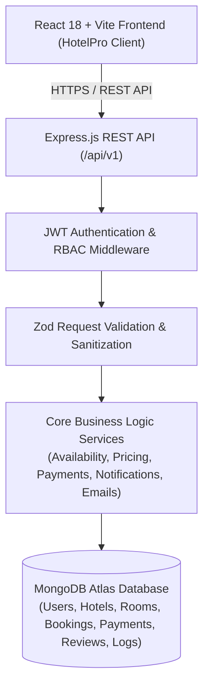

# HotelPro — Full-Stack Hotel Booking and Management System

[]()
[-blue.svg)]()
[]()

> **HotelPro** is an enterprise-grade, production-minded hotel booking and hospitality management web application built with the MERN stack. Designed to power independent boutique retreats and luxury hospitality chains, HotelPro provides an intuitive guest booking journey, operational front-desk tools for staff, and executive intelligence dashboards for administrators.

---

## 📑 Table of Contents
1. [Key Features Overview](#-key-features-overview)
2. [Technology Stack](#-technology-stack)
3. [System Architecture](#-system-architecture)
4. [Database Design & Schema Overview](#-database-design--schema-overview)
5. [Anti-Double-Booking & Pricing Logic](#-anti-double-booking--pricing-logic)
6. [Local Installation & Setup](#-local-installation--setup)
7. [Environment Variables Reference](#-environment-variables-reference)
8. [Automated Testing Suite](#-automated-testing-suite)
9. [Interactive API Documentation (Swagger)](#-interactive-api-documentation-swagger)
10. [Deployment Guide (Vercel + Render + MongoDB Atlas)](#-deployment-guide-vercel--render--mongodb-atlas)
11. [Requirements-to-Features Mapping Checklist](#-requirements-to-features-mapping-checklist)
12. [Mentor Demonstration Guide (Step-by-Step)](#-mentor-demonstration-guide-step-by-step)

---

## 🌟 Key Features Overview

### 1. Guest / Customer Journey
- **Real-Time Room Search & Filters**: Live availability checking by check-in/check-out dates, guest capacity, price range, room type, and luxury amenities.
- **Transparent Price Breakdown**: Automatic calculation of nights, base rate, hospitality tax (12%), and cleaning fee snapshots with no hidden fees.
- **Atomic Booking Engine**: Concurrency control preventing overlapping reservations for the same room.
- **Sandbox Payment Simulation**: Built-in payment gateway simulator supporting card tokenization and idempotency with instant celebration confetti.
- **Customer Dashboard**: Overview of upcoming, completed, and cancelled reservations.
- **Cancellation & Refunds**: Automatic policy enforcement (free cancellation up to 24h prior to arrival) with instant refund tracking.
- **Verified Reviews**: 1 to 5 star rating submission restricted to verified completed stays.
- **Printable Tax Invoices**: Itemized tax invoice with booking reference, dates, itemized fees, and hotel contact details.

### 2. Hotel Staff Operations Portal
- **Daily Operations KPI Hub**: Live counters for today's expected arrivals, departures, occupied rooms, and turn cleans.
- **Front-Desk Check-In / Check-Out**: One-click guest verification; checking out a guest automatically dispatches the room for housekeeping cleaning.
- **Physical Status Management**: Independent tracking of room physical states (`available`, `occupied`, `cleaning`, `maintenance`) without breaking calendar booking availability.
- **Housekeeping Task Dispatch**: Prioritized task board (`urgent`, `high`, `medium`) with notes and completion tracking.
- **Guest Service Tickets**: Real-time room service, extra supplies, and maintenance request fulfillment.

### 3. Administrator Console & Business Intelligence
- **Executive Dashboard**: Real-time KPIs calculated directly from database records (Gross Revenue, Total Bookings, Occupancy Rate, Registered Customers).
- **Interactive Visualizations (Recharts)**: Monthly revenue trend charts and inventory distribution by room category.
- **Room Catalog Management**: Full CRUD for rooms, seasonal multipliers, capacity, dimensions, amenities chips, and photos.
- **Reservations Moderation**: Global booking ledger with search, filter, status overrides, and refund processing.
- **Staff & Role-Based Access Control (RBAC)**: Create new staff and administrator accounts securely; activate or deactivate accounts.
- **1-Click CSV Reports**: Export comprehensive Bookings CSV and Financial Revenue CSV ledgers for external accounting.
- **Policy Settings & Audit Trail**: Configurable hotel tax percentages, cleaning fees, cancellation windows, and immutable system audit logs.

---

## 🛠 Technology Stack

| Layer | Technologies |
| :--- | :--- |
| **Frontend** | React 18, Vite, React Router 6, Bootstrap 5.3, React-Bootstrap, Lucide React, Recharts, Canvas Confetti, Axios |
| **Backend** | Node.js, Express.js, Mongoose ODM, Zod, JWT (`jsonwebtoken`), bcryptjs, Helmet, CORS, Express-Rate-Limit, Morgan, Nodemailer |
| **Database** | MongoDB Atlas (Production) / Embedded In-Memory MongoDB (Local Dev & Testing fallback) |
| **Documentation** | OpenAPI 3.0 / Swagger UI (`/api/docs`) |
| **Testing** | Vitest, Supertest |
| **Deployment** | Vercel (Frontend SPA), Render (Backend REST Service), MongoDB Atlas (Cloud Database) |

---

## 🏛 System Architecture



---

## 🗄 Database Design & Schema Overview

HotelPro models are built with strict Mongoose validation, indexes, and referential integrity:

1. **`User`**: Full Name, Email (unique index), Password Hash (`bcryptjs`), Phone, Role (`customer`, `staff`, `admin`), isActive, Avatar.
2. **`Hotel`**: Property Name, Tagline, Address, City (indexed), Amenities, Contact details, Check-in/out policies.
3. **`Room`**: Hotel ref, Room Number (unique index), Title, Category (`single`, `double`, `deluxe`, `suite`, `presidential`), Base Price, Seasonal Multiplier, Capacity (`adults`, `children`, `maxGuests`), Bedding, Dimensions, Amenities, Photos, Physical Status (`available`, `occupied`, `cleaning`, `maintenance`), isActive.
4. **`Booking`**: Unique Reference (`HP-XXXXX`), User ref, Room ref, Hotel ref, Check-in Date, Check-out Date, Total Nights, Guest Details, Price Breakdown Snapshot (`nightlyRate`, `subtotal`, `taxes`, `cleaningFee`, `totalAmount`), Status (`pending_payment`, `confirmed`, `checked_in`, `completed`, `cancelled`), Cancellation details, Payment ref. Compound index on `(room, status, checkInDate, checkOutDate)`.
5. **`Payment`**: Booking ref, User ref, Amount, Currency, Provider (`sandbox`, `razorpay`, `stripe`), Transaction ID (unique), Payment Method, Card Last 4, Status (`captured`, `refunded`), Timestamps.
6. **`Review`**: Booking ref (unique: 1 review per stay), Room ref, User ref, Star Rating (1-5), Title, Comment, isApproved.
7. **`Notification`**: Recipient ref, Role Target, Title, Message, Type, isRead, Timestamps.
8. **`Housekeeping`**: Room ref, Assigned Staff ref, Task Type, Priority, Status, Notes.
9. **`ServiceRequest`**: Room ref, Guest ref, Request Type, Description, Status, ResolvedBy ref.
10. **`AuditLog`**: User ref, Operator Name, Action, Entity, EntityId, Details, IP Address, Timestamps.
11. **`HotelSetting`**: Hotel Name, Tax Percentage, Cleaning Fee, Cancellation Window Hours, Support Contact.

---

## 🔒 Anti-Double-Booking & Pricing Logic

### 1. Overlapping Interval Check
A room is unavailable if any active booking exists where:
$$\text{ExistingCheckIn} < \text{RequestedCheckOut} \quad \text{AND} \quad \text{ExistingCheckOut} > \text{RequestedCheckIn}$$
Statuses that block inventory: `confirmed`, `checked_in`, `pending_payment`. Cancelled bookings release inventory immediately.

### 2. Pricing Snapshot Formula
Historical invoices remain invariant when room base prices are adjusted in the admin panel:
$$\text{Total Nights} = \max\left(1, \left\lceil \frac{\text{CheckOut} - \text{CheckIn}}{86,400,000 \text{ ms}} \right\rceil\right)$$
$$\text{Subtotal} = \text{Nightly Rate} \times \text{Total Nights}$$
$$\text{Taxes} = \text{Subtotal} \times \left(\frac{\text{Tax Rate \%}}{100}\right)$$
$$\text{Final Total} = \text{Subtotal} + \text{Taxes} + \text{Cleaning Fee} - \text{Discount}$$

---

## 🚀 Local Installation & Setup

### Prerequisites
- Node.js (v18.0.0 or higher)
- npm (v9.0.0 or higher)

### 1. Clone & Install Dependencies
```bash
# Clone the repository
git clone https://github.com/your-username/hotelpro.git
cd hotelpro

# Install Backend dependencies
cd server && npm install

# Install Frontend dependencies
cd ../client && npm install
cd ..
```

### 2. Configure Environment Variables
```bash
# In the server directory, copy the example environment file:
cp server/.env.example server/.env
```
*(HotelPro automatically connects to local or in-memory MongoDB if external Atlas credentials are not provided).*

### 3. Start Backend & Frontend
```bash
# Terminal 1: Run Express Server (Port 5001)
cd server
npm run dev

# Terminal 2: Run React Client (Port 5173)
cd client
npm run dev
```
Open your browser to: **`http://localhost:5173`**

---

## 🔑 Default Demo Accounts

HotelPro includes safe demo seed data with 1-click credential buttons on the login page:

| Role | Email | Password | Permissions |
| :--- | :--- | :--- | :--- |
| **Customer / Guest** | `guest@hotelpro.com` | `Guest@HotelPro2026` | Search, Book, Manage Reservations, Invoices, Reviews |
| **Hotel Staff** | `staff@hotelpro.com` | `Staff@HotelPro2026` | Check-in, Check-out, Housekeeping Tasks, Guest Service Tickets |
| **Administrator** | `admin@hotelpro.com` | `Admin@HotelPro2026` | Full Control, Analytics, Room CRUD, User Management, CSV Exports |

---

## 🧪 Automated Testing Suite

HotelPro contains an automated test suite verifying authentication, room calculations, double-booking prevention, cancellations, and staff/admin workflows:

```bash
cd server
npm test
```

### Test Results
```
 ✓ test/api.test.js (16 tests)
   ✓ Health and System Status
     ✓ should return healthy status on GET /api/v1/health
   ✓ Authentication & Role-Based Authorization
     ✓ should register a new customer
     ✓ should prevent duplicate email registration
     ✓ should prevent password mismatch during registration
     ✓ should reject login with wrong password
     ✓ should prevent non-admin from creating rooms (Role check)
   ✓ Rooms & Availability Engine
     ✓ should list available rooms with filters
     ✓ should calculate stay price correctly with taxes and cleaning fee
   ✓ Booking Lifecycle & Double-Booking Prevention
     ✓ should create a valid booking and return unique reference
     ✓ should PREVENT overlapping reservation for the same room (Double-booking test)
     ✓ should process sandbox payment and transition status to confirmed
     ✓ should retrieve booking invoice
     ✓ should cancel eligible booking and process refund record
   ✓ Staff & Administrator Dashboards
     ✓ should return staff operations summary
     ✓ should return admin dashboard statistics calculated from database
     ✓ should export bookings to CSV

Test Files  1 passed (1)
     Tests  16 passed (16)
```

---

## 📖 Interactive API Documentation (Swagger)

Start the server and visit:
```
http://localhost:5001/api/docs
```
Explore request/response schemas, try live endpoints, and test JWT authentication directly from the interactive OpenAPI UI.

---

## 🌐 Deployment Guide (Vercel + Render + MongoDB Atlas)

### 1. MongoDB Atlas Setup
1. Create a free M0 cluster on [MongoDB Atlas](https://www.mongodb.com/atlas).
2. Create a database user and allow network access (`0.0.0.0/0` or Render outbound IPs).
3. Copy the connection string: `mongodb+srv://<user>:<password>@cluster0.mongodb.net/hotelpro?retryWrites=true&w=majority`.

### 2. Render Deployment (Backend)
1. Link your GitHub repository to [Render](https://render.com).
2. Create a new **Web Service**:
   - **Root Directory**: `server`
   - **Build Command**: `npm install`
   - **Start Command**: `npm start`
   - **Health Check Path**: `/api/v1/health`
3. Configure Environment Variables in Render:
   - `NODE_ENV`: `production`
   - `PORT`: `5001`
   - `MONGODB_URI`: `<Your MongoDB Atlas URI>`
   - `JWT_SECRET`: `<A strong random 64-character secret>`
   - `CLIENT_URL`: `https://your-hotelpro-client.vercel.app`
   - `PAYMENT_PROVIDER`: `sandbox`
   - `ADMIN_EMAIL`: `admin@hotelpro.com`
   - `ADMIN_PASSWORD`: `<Your secure admin password>`

### 3. Vercel Deployment (Frontend)
1. Link your GitHub repository to [Vercel](https://vercel.com).
2. Set **Root Directory** to `client`.
3. Framework Preset: `Vite`.
4. Configure Environment Variable:
   - `VITE_API_BASE_URL`: `https://hotelpro-server.onrender.com/api/v1`
5. Deploy! Vercel will use `client/vercel.json` for SPA rewrites so deep links work without 404s.

---

## 📋 Requirements-to-Features Mapping Checklist

| Section | Requirement | Status | Verification Detail |
| :--- | :--- | :--- | :--- |
| **System Identity** | Consistent branding as HotelPro | ✅ Complete | Resolved legacy name conflicts; branded across client, server, and docs. |
| **Authentication** | Customer Registration & Login | ✅ Complete | Email uniqueness check, password strength meter, confirm password match. |
| **Security** | Password Hashing & JWT | ✅ Complete | bcryptjs 10 salt rounds, JWT expiry, role checks on server endpoints. |
| **Security** | No Public Admin Registration | ✅ Complete | Public register route defaults strictly to `customer`. Admin created via seed script / env var. |
| **Browsing** | Search & Filter Accommodations | ✅ Complete | Check-in, check-out, guests count, room category, max price, sorting. |
| **Room Details** | Live Price Breakdown | ✅ Complete | Dynamic calculation of nights, base rates, 12% tax, and cleaning fees. |
| **Booking** | Concurrency & Anti-Double-Booking | ✅ Complete | Atomic interval overlap detection prevents double booking. Verified by test suite. |
| **Payments** | Sandbox Payment Gateway | ✅ Complete | Built-in sandbox simulation, card tokenization, signature validation, idempotent status. |
| **Invoices** | Itemized Tax Invoices | ✅ Complete | Formatted HTML tax invoice at `/api/v1/bookings/:id/invoice?format=html`. |
| **Customer** | Dashboard & My Reservations | ✅ Complete | View active and past stays, cancel booking, download invoice, submit verified review. |
| **Staff** | Daily Operations & Check-in/out | ✅ Complete | Arrivals list, departures list, one-click check-in, check-out with auto-housekeeping dispatch. |
| **Staff** | Physical Housekeeping Status | ✅ Complete | Separated physical room status (`available`, `occupied`, `cleaning`, `maintenance`) from calendar booking. |
| **Admin** | Real DB Analytics & Recharts | ✅ Complete | Executive KPIs, monthly revenue area chart, room inventory distribution bar chart. |
| **Admin** | Room CRUD & User Management | ✅ Complete | Add/edit suites, archive rooms, create staff accounts, toggle user active status. |
| **Admin** | CSV Reports Export | ✅ Complete | 1-Click download of Bookings CSV and Revenue Ledger CSV. |
| **Admin** | Audit Trail & Hotel Settings | ✅ Complete | Immutable audit log of administrative and financial operations. |

---

## 🎓 Mentor Demonstration Guide (Step-by-Step)

Follow this exact walkthrough to evaluate all critical flows:

### Step 1: Customer Account & Room Browsing
1. Open the landing page at `http://localhost:5173`.
2. Notice the luxury hero banner, the quick booking search widget, featured suites, and amenities.
3. Click **"Explore Rooms"** in the navigation bar.
4. Filter by category (e.g. *Deluxe* or *Suite*) or adjust the maximum price slider.
5. Click **"Reserve"** on any suite to open the **Room Details** page.

### Step 2: Live Pricing & Transparent Calculation
1. On the Room Details page, select a check-in date and check-out date (e.g. 3 nights).
2. Notice the live price breakdown calculating nights, room subtotal, 12% hospitality tax, and cleaning fee.
3. Click **"Proceed to Checkout"**.

### Step 3: Registration & Authentication
1. If not logged in, the application directs you to login. Click the **"👤 Guest"** demo pill for 1-click test fill (`guest@hotelpro.com`), or click **"Create Account"** to test fresh customer signup.
2. Sign in to proceed directly to the checkout review page.

### Step 4: Making a Reservation & Test Payment
1. Review the guest details, stay summary, and transparent price total.
2. Under Payment Method, select **"Credit / Debit Card (Sandbox)"** (pre-loaded with Visa test card).
3. Click **"Confirm & Pay"**.
4. Enjoy the celebratory confetti animation and instant booking confirmation displaying your unique reference (e.g. `HP-XXXXX`).

### Step 5: Customer Management, Invoices & Reviews
1. Click **"View in My Bookings"** (or click *My Bookings* in the top navbar).
2. Click **"Tax Invoice"** to open the itemized printable tax invoice.
3. Click **"Review"** on a completed/confirmed booking to submit a 1 to 5 star rating and comment.
4. Click **"Cancel"** on an eligible booking to view the cancellation policy confirmation and process a refund.

### Step 6: Hotel Staff Operations Desk
1. Click the profile avatar in the navbar and select **"Sign Out"**.
2. Click **"Sign In"** and click the **"🛎️ Hotel Staff"** demo pill (`staff@hotelpro.com` / `Staff@HotelPro2026`).
3. View the live operations overview: Expected Arrivals, Departures, Occupancy Rate, and Housekeeping counter.
4. Navigate to the **"Guest Check-In"** tab: click **"Verify & Check-in"** to admit an arriving guest (sets room to *Occupied*).
5. Navigate to the **"Guest Check-Out"** tab: click **"Process Check-out"** (automatically dispatches a cleaning task to housekeeping!).
6. View the **"Housekeeping Dispatch"** tab and mark a cleaned room as completed.

### Step 7: Executive Administrator Console
1. Log in using the **"🛡️ Administrator"** demo pill (`admin@hotelpro.com` / `Admin@HotelPro2026`).
2. Explore the Executive Dashboard: real database-calculated revenue, occupancy rate, Recharts revenue trend chart, and category bar chart.
3. Switch to **"Rooms & Inventory"**: click **"Add New Suite"** to create a new room, or edit an existing suite.
4. Switch to **"Users & Staff"**: click **"Add Staff Account"** to onboard a new employee, or toggle user activation status.
5. Switch to **"Financial Reports"**: click **"Export Bookings CSV"** or **"Export Revenue CSV"** to download real CSV spreadsheets.
6. Switch to **"Policies & Audit Trail"**: observe the live audit logs recording every check-in, check-out, and cancellation.

### Step 8: Double-Booking Prevention Verification
1. Run the automated test suite in terminal: `cd server && npm test`.
2. Notice the test **`should PREVENT overlapping reservation for the same room (Double-booking test)`** passing with code `409 Conflict`.
3. Try booking the exact same room for the same dates in the UI to see the live alert: *"This suite is currently reserved for the selected dates"*.
